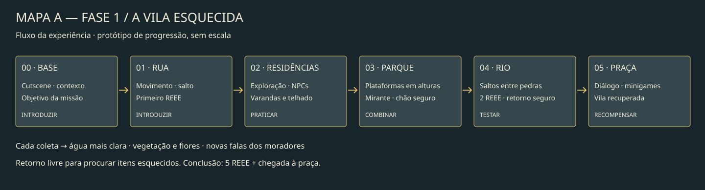

# Fase 1 — fluxo e blockout

Abra `levels/phase1/phase1.tscn`. O cenário usa formas simples para avaliar percurso e dificuldade antes da arte final.

## Mapa A — fluxo da experiência

Base → Rua → Residências → Parque → Rio → Praça de reciclagem.
A exploração é reversível: é possível voltar para buscar qualquer REEE esquecido. A conclusão exige os cinco resíduos e a chegada à praça, em terreno seguro.

| Etapa | Faixa X | Experiência | Coleta |
| --- | --- | --- | --- |
| Base | −300 a 350 | Abertura, contexto e pedido dos moradores | — |
| Rua | 350 a 1150 | Introduzir movimento e salto com um bloqueio baixo | Celular |
| Residências | 1150 a 2300 | Praticar subida, conversar e procurar acima da rua | Fios no telhado |
| Parque | 2300 a 3500 | Combinar saltos e alturas até o mirante; chão permite repetir | Peça de computador |
| Rio | 3500 a 4750 | Testar saltos com alturas e intervalos diferentes | Placa e componente |
| Praça | 4750 a 5400 | Diálogo, minigames e contemplação da recuperação | Conclusão |

## Edição no Godot

- `Bricks`: chão, blocos e plataformas, pintados com o tileset de tijolos (veja "Tiles").
- `HouseColliders`: muro do quintal, varanda e laje. Só colisão: a arte está nas casas, então mover um deles exige ajustar a casa.
- `Flow`: marcos das áreas, nomes e dicas no metadata. Mantenha a ordem horizontal dos marcos. As dicas acompanham esses marcos.
- `Reee*`: círculos amarelos coletáveis. As posições em altura tornam a exploração necessária.
- `RiverCheckpoint`: retorno seguro após cair no rio. A queda não apaga coletas.
- `FinishPoint`: posição do encontro final. Mantenha sobre piso, longe das bordas.
- `Restoration`: progresso de limpeza (REEE coletados ÷ total). `Background`, `Scenery`, os tijolos, a `RiverWater` e os moradores reagem a ele.

As plataformas ficam dentro do alcance do salto atual (velocidade inicial 750, gravidade aplicada por quadro). Segurar o botão permite o salto mais alto. A rua e o parque têm chão de recuperação; no rio, a queda abaixo de `fall_reset_y` retorna à margem inicial. Os caminhos também permitem a travessia no sentido contrário.

## Tiles

Tileset: `assets/tilesets/bricks_tileset.tres`, tiles de **16×16 px** (tijolo de 16×8). Tem dois terrenos:
*Muro de tijolos* (capa de concreto no topo) e *Plataforma de tijolos* (fiada em pé no topo, dentículos embaixo).

- Para construir, selecione `Bricks`, abra a aba **TileMap > Terrains**, escolha o terreno e pinte. Bordas, cantos e
  emendas são escolhidos automaticamente; os tiles mais repetidos variam sozinhos (sujeira e musgo).
- A colisão vem nos tiles. Plataformas têm 1 tile de altura; pedras e blocos, 2 ou mais.
- A camada fica em `y = 8`: assim as linhas da grade passam em `y = 40`, a altura do chão da fase.
  Em fases novas, mantenha esse deslocamento se o chão continuar em `y = 40`.
- Para outra camada de tiles restaurável, use `RestorableTileMapLayer` com `clean_texture = bricks_limpo.png`.
- Arte: `assets/tilesets/aseprite/bricks.aseprite` (grade de 16 já configurada). Mantenha a posição de cada tile no atlas;
  o `bricks_tiles.json` descreve terreno e vizinhos de cada um. Para regenerar:
  `python3 tools/tiles/build_bricks_tileset.py` e depois `godot --headless --path . -s res://tools/tiles/build_bricks_tileset.gd`.

## Recompensa e narrativa

Cada coleta clareia o céu e a água e restaura parte das casas, árvores e objetos do fundo. A partir de 60%, os NPCs têm uma nova fala de recuperação, ouvida ao se aproximar novamente.

O quadro de instruções e sua narração ficam suspensos durante cutscenes, conversas e minigames. Ao voltar ao jogo, a dica vigente reaparece. A conclusão inicia apenas uma vez, na praça, após todas as coletas.

## Próximas iterações

A geometria atual é um protótipo com plataformas fixas. Plataformas móveis, inimigos, dano na água, portões e arte final ficam para uma próxima etapa. Se uma plataforma móvel for adicionada, introduza uma sobre o chão do parque, pratique uma segunda e só depois combine a mecânica com a travessia do rio.

Antes de finalizar as medidas, faça uma passagem manual com teclado e controle, observe os saltos de jogadores novos e ajuste distâncias, câmera e tempo de leitura das dicas.
